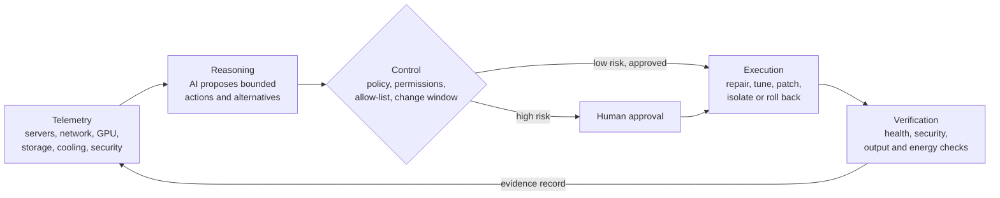

  

<h1 align="center">Khaled Hassan</h1>

  <b>Astrophysicist by training · Infrastructure engineer by trade · Founder of ResiliaAI™</b> 
  Lead, Enterprise Research Computing &amp; AI-Enabled Infrastructure at KAUST 
  Founder and Principal Consultant, Alhassan Consultancy Canada Inc.

  
  
  
  

---

## About me

I started my career studying how stars and galaxies behave. I have spent the 25+ years since building the computing systems that let other scientists do the same: supercomputers, GPU clusters and research platforms that must not fail.

I came to computing through science. My degrees are in astronomy and astrophysics, and I spent the 1990s in research and teaching. That training still drives how I work. I start from measurements, form a hypothesis, test it, and only then change something. I treat a production system the way an astronomer treats a telescope: an instrument that must be calibrated, understood and trusted before you can believe anything it tells you.

I moved from science into engineering at the end of the 1990s, and my career has taken me through some of the most demanding environments an engineer can work in. I supported trading systems on Wall Street and helped rebuild them after September 11. I kept mission-critical systems running for one of the world's largest energy companies. For nearly two decades I have helped build and run the research computing behind King Abdullah University of Science and Technology (KAUST), from before the university opened its doors to today's hybrid platform of HPC, GPU clusters, Kubernetes and three public clouds.

Each of those places taught me the same lesson from a different angle. Systems fail. What matters is how quickly you notice, how safely you recover, and whether you learn enough to stop it happening again. I have spent my career getting better at all three, and I have tried to pass that on: I have managed and mentored engineers for more than five years across KAUST and Saudi Aramco, and I measure a good team by how calm it is during an outage.

In 2024 I began consulting independently, and in 2026 I founded **Alhassan Consultancy Canada Inc.** in Mississauga, Ontario. There I designed **ResiliaAI™**, a patent-pending platform for self-healing infrastructure that stays under human control. It brings together everything I have learned: AI that can reason about a failing system, wrapped in the policies, approvals and evidence that real operations teams and regulators need before they will let anything act on its own.

I am a Canadian citizen based in Mississauga, Ontario.

## Career at a glance

| Years | Role | Organization |
| --- | --- | --- |
| 2024 – present | Founder and Principal Consultant | Alhassan Consultancy Canada Inc., Mississauga |
| 2018 – present | Lead, Enterprise Research Computing & AI-Enabled Infrastructure | King Abdullah University of Science and Technology (KAUST) |
| 2008 – 2018 | Senior System Engineer | KAUST |
| 2001 – 2008 | UNIX/Linux & High Availability Consultant | Saudi Aramco, Dhahran |
| 1999 – 2001 | Senior Financial Services Engineer | Merrill Lynch, New York |
| 1991 – 1999 | Research and teaching, astronomy and astrophysics | |
| 1989 – 1991 | BSc Astronomy; Postgraduate Degree, Astrophysics | Cairo University |

---

## From the stars to the server room

**Astronomy and astrophysics (1989 – 1999).** I earned a Bachelor of Science in Astronomy (1989) and a postgraduate degree in Astrophysics (1991) at Cairo University, then spent most of the 1990s in research and teaching. Astrophysics is a data problem as much as a physics problem. The observations are noisy, the models are heavy, and the answer is only as good as the computation behind it. That is where I learned to treat computers as scientific instruments: they have to be calibrated, understood and trusted, or the results mean nothing.

**Wall Street, September 2001 (1999 – 2001).** At Merrill Lynch in New York I supported the Sun Enterprise systems behind trading and forecasting. After the attacks of September 11, I helped rebuild trading environments so displaced teams could get back to work. Nothing has shaped how I think about resilience more. Disaster recovery is not a document; it is what you can actually stand back up, under pressure, for people who are depending on you.

**Energy at national scale (2001 – 2008).** At Saudi Aramco I was a UNIX/Linux and high-availability consultant for mission-critical SAP environments that served bulk plants and offshore vessels. I worked on clustering, SAN storage, backup, disaster recovery and capacity analysis, and I managed engineers. When the systems that move a country's energy go down, the cost is counted in more than money.

**Research computing at KAUST (2008 – present).** I joined KAUST as a Senior System Engineer when the university was being built, and helped stand up its research and enterprise platforms: 200+ servers serving 3,000+ concurrent users, high-availability storage, data centre migrations and the full RHEL lifecycle. Since 2018 I have led enterprise research computing and AI-enabled infrastructure. I designed and run a hybrid platform that spans bare-metal HPC and SLURM-scheduled GPU clusters, Kubernetes, VMware, OpenStack and Azure, AWS and GCP, all defined as code with Terraform and Ansible.

Along the way:

- Automation across the fleet raised overall system efficiency by **35%**.
- Git-based CI/CD and testing made delivery **25% faster** with **25% fewer defects**.
- An AI-assisted deployment scheduler I built rolls changes out safely across the fleet.
- Mentoring the engineers on my teams lifted productivity by **15%**.

**Founder, Alhassan Consultancy Canada Inc. (2024 – present).** I have consulted independently under the Alhassan name since 2024 and incorporated the company in Canada in 2026. We help organizations that cannot afford downtime build secure, resilient, self-healing IT. That work includes resilience assessments, modernization of Linux, cloud, HPC and GPU platforms, automation, and managed operations, including consulting on an airport infrastructure project in Dubai.

---

## ResiliaAI™: self-healing infrastructure that answers to people

After three decades of being woken up at 3 a.m., I wanted to know why the same failures keep coming back, and why the tools meant to fix them so often can't be trusted to act alone. ResiliaAI is my answer.

It is a **policy-governed, active-AI control and evidence platform**. It watches servers, networks, storage and GPU systems, works out what is wrong, and fixes it, but only through actions that have been approved in advance and that leave a complete audit trail. High-risk actions always go to a person.

### The design principle

Most AI-operations tools let a model decide *and* act. ResiliaAI separates the two:

> **The AI advises. Approved code acts. Every action leaves evidence.**

The language model is an advisor. It reasons over telemetry, policies, vendor guidance and past incidents to propose a fix. The fix itself is carried out only by version-controlled, allow-listed runbooks, within permissions, change windows and operating limits, and with an emergency stop.

### How it works

| Layer | What it does | What it records |
| --- | --- | --- |
| **Telemetry** | Collects approved signals from workloads, services, CPUs, GPUs, storage, cooling, patching and security tools | Source, asset, timestamp, integrity |
| **Reasoning** | Uses approved models, policies and prior evidence to propose bounded actions | Sources consulted, alternatives considered, policy result |
| **Control** | Enforces permissions, the runbook allow-list, operating limits, change windows and the emergency stop | Approval, code version, parameters |
| **Execution** | Schedules, tunes, power-caps, repairs, patches, isolates or rolls back through approved integrations | Commands, outputs, state changes |
| **Verification** | Tests service health, security, accepted output and energy use before an action counts as done | Before-and-after result, acceptance decision, rollback evidence |

Every action produces a before-and-after record. An auditor, an engineer or a regulator can see what happened, why, who approved it, and how to undo it.

### Where it is going

- **Patent pending:** Canadian patent application filed in September 2026, *"Systems and Methods for Policy-Governed AI-Based Infrastructure Monitoring and Automated Remediation."*
- **Trademark:** RESILIAAI, Canadian trademark application filed in 2026.
- **Aerospace R&D:** lead applicant in a proposed collaborative R&D project applying ResiliaAI to aerospace simulation, digital-twin and maintenance-diagnostic infrastructure, aiming to cut the energy used per unit of useful computing work without giving up availability, security or administrator control.
- **Sovereign AI compute:** architecture for a proposed Canadian-hosted AI compute and resilience centre: a GPU cluster, a high-speed network fabric, parallel storage, immutable backup, and power and liquid cooling.

---

## What I work with

| Area | Tools and practice |
| --- | --- |
| **HPC and GPU** | SLURM, GPU clusters for ML training and inference, capacity planning, MLflow, remote visualization |
| **Hybrid cloud** | Kubernetes, Docker/OCI, VMware, OpenStack, Azure, AWS, GCP, bare metal |
| **Automation** | Terraform, Ansible, Puppet, Python, Bash, Git, CI/CD, Kickstart, cloud-init |
| **Linux internals** | RHEL, Rocky, SLES, Ubuntu, Debian; kernel and performance tuning, systemd, SELinux, CIS and STIG hardening |
| **Networking** | VLANs and segmentation, BGP, OSPF, IPsec VPN, firewalls, DNS, DHCP |
| **Storage** | NetApp, Pure Storage, SAN/NAS, NFS, high availability, backup and disaster recovery |
| **Security and operations** | PKI and certificates, AD/LDAP/SSSD, Prometheus, Grafana, incident response, ITIL change control |

## Portfolio

| Project | What it does |
| --- | --- |
| [`linux-infrastructure-toolkit`](https://github.com/hassankx/linux-infrastructure-toolkit) | Read-only health check for fast assessment of a Linux host |
| [`gpu-platform-readiness`](https://github.com/hassankx/gpu-platform-readiness) | NVIDIA driver, GPU health, CUDA, PyTorch and SLURM node readiness checks |
| [`linux-incident-triage`](https://github.com/hassankx/linux-incident-triage) | Safe, timestamped evidence collection for first-response troubleshooting |

These are small public tools in the same spirit as ResiliaAI: observe safely first, collect evidence, change nothing without a reason.

## How I work

Stabilize the service first. Find the root cause. Then automate the prevention, so nobody has to fight the same fire twice. Whether the subject is a galaxy or a GPU cluster, I trust measurements over assumptions.

## Credentials

**Education:** Postgraduate Degree in Astrophysics (1991) and BSc in Astronomy (1989), Cairo University

**Certifications:** RHCE · RHCSA · CompTIA Security+ · CompTIA CySA+ · CompTIA Linux+ · ITIL Foundation · ISO/IEC 20000 · Cloud Computing Foundation · Sun Certified UNIX System Administrator · Sun Cluster Systems Installer

## Connect

- LinkedIn: https://www.linkedin.com/in/khaled-hassan-elmahroqi/
- Based in Mississauga, Ontario, Canada

> The public projects here are sample-safe tools written for this portfolio. They contain no employer or client systems, configurations, credentials or confidential information. ResiliaAI source code and patent materials are not published.
