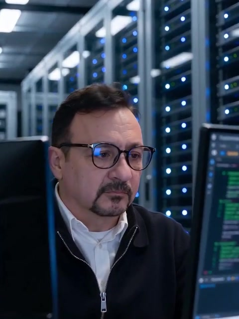
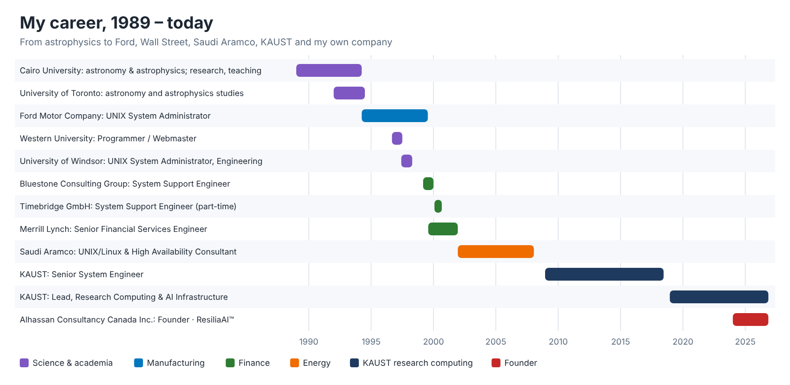
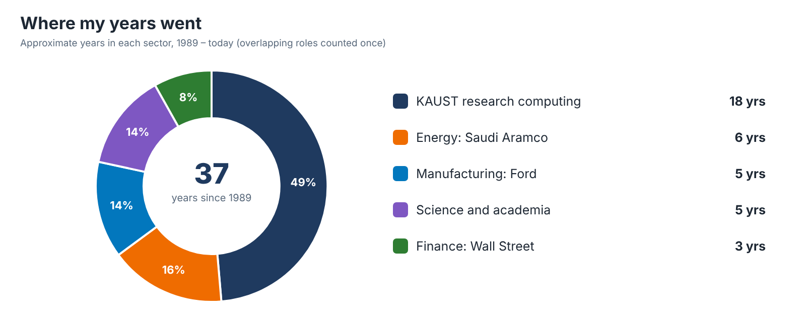
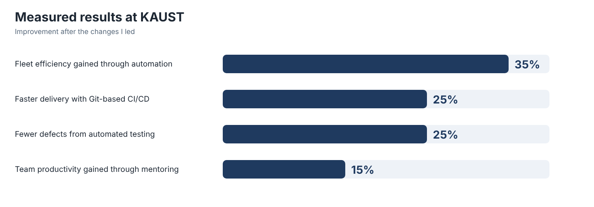
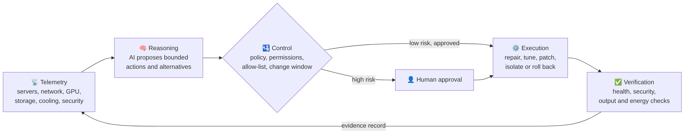

  

<table>
<tr>
<td width="32%" align="center" valign="top">
   
  <b>Khaled Hassan</b> 
  Mississauga, Ontario, Canada  
  
</td>
<td valign="top">

### Hello, I'm Khaled 👋

I trained as an **astrophysicist** and became an **infrastructure engineer**. For more than 30 years I have built and run the computing that manufacturing, science, finance and energy depend on, and I am now building a company to make that computing heal itself, safely.

| | |
| --- | --- |
| 🏛️ **Today** | Lead, Enterprise Research Computing & AI-Enabled Infrastructure at **KAUST** |
| 🚀 **Founder** | **Alhassan Consultancy Canada Inc.** and creator of **ResiliaAI™** (patent pending) |
| 🔭 **Trained in** | Astronomy (BSc) and Astrophysics (postgraduate), Cairo University |
| 🧠 **Known for** | HPC and GPU clusters, Kubernetes, enterprise Linux, hybrid cloud, cyber-resilience |
| 🤝 **Open to** | Infrastructure leadership, HPC and AI platform roles, and ResiliaAI partnerships |

</td>
</tr>
</table>

---

## 📊 At a glance

<table>
<tr>
<td align="center" width="25%"><h2>30+</h2>years building critical infrastructure</td>
<td align="center" width="25%"><h2>3,000+</h2>concurrent users served at KAUST</td>
<td align="center" width="25%"><h2>200+</h2>servers in the platforms I ran</td>
<td align="center" width="25%"><h2>9</h2>employers, including Ford, Merrill Lynch, Saudi Aramco and KAUST</td>
</tr>
<tr>
<td align="center"><h2>35%</h2>fleet efficiency gained through automation</td>
<td align="center"><h2>25%</h2>faster delivery with Git-based CI/CD</td>
<td align="center"><h2>25%</h2>fewer defects from automated testing</td>
<td align="center"><h2>15%</h2>team productivity gained through mentoring</td>
</tr>
<tr>
<td align="center"><h2>3</h2>public clouds run alongside bare metal</td>
<td align="center"><h2>5</h2>years running SLURM GPU and HPC clusters</td>
<td align="center"><h2>10</h2>professional certifications</td>
<td align="center"><h2>1</h2>Canadian patent application pending</td>
</tr>
</table>

---

## 🌌 About me

I came to computing through science. My degrees are in astronomy and astrophysics, and I started my career in research and teaching. Astrophysics is a data problem as much as a physics problem: the observations are noisy, the models are heavy, and an answer is only as good as the computation behind it. That is where I learned to treat a computer as a scientific instrument, something to be calibrated, understood and trusted before you believe anything it tells you.

I still work that way. I start from measurements, form a hypothesis, test it, and only then change something.

In 1994 I moved from science into engineering as a UNIX system administrator at Ford Motor Company, running the servers behind its worldwide CAD/CAM/CAE engineering data, while also working in university computing at Western University and the University of Windsor. Since then my career has taken me through some of the most demanding environments an engineer can work in. I ran Sun Enterprise 10000 systems as a consultant, supported trading systems on Wall Street and helped rebuild them after September 11. I kept mission-critical systems running for one of the world's largest energy companies. For nearly two decades I have helped build and run the research computing behind King Abdullah University of Science and Technology, from before the university opened its doors to today's hybrid platform of HPC, GPU clusters, Kubernetes and three public clouds.

Each of those places taught me the same lesson from a different angle. **Systems fail. What matters is how quickly you notice, how safely you recover, and whether you learn enough to stop it happening again.** I have spent my career getting better at all three and passing that on. I have managed and mentored engineers for more than five years across KAUST and Saudi Aramco, and I measure a good team by how calm it is during an outage.

In 2024 I began consulting independently, and in 2026 I founded **Alhassan Consultancy Canada Inc.** There I designed **ResiliaAI™**, which brings everything I have learned together: AI that can reason about a failing system, inside the policies, approvals and evidence that real operations teams and regulators need before they will let anything act on its own.

I am a Canadian citizen based in Mississauga, Ontario.

 

---

## 🛰️ My journey

---

## 🏆 Achievements in detail

### 🏛️ KAUST: Lead, Enterprise Research Computing & AI-Enabled Infrastructure (2018 – today)

| Challenge | What I did | Result |
| --- | --- | --- |
| Researchers needed every kind of compute, from bare metal to the cloud | Designed and run one hybrid platform: bare-metal HPC and SLURM GPU clusters, Kubernetes, VMware, OpenStack, and Azure, AWS and GCP | One platform used by research and engineering teams across the university |
| Hand-built servers drift and break | Defined the platform as code with Terraform and Ansible in Git, pushing consistent configuration across the fleet | **35%** higher overall system efficiency |
| Releases were slow and risky | Introduced Git-based CI/CD and automated testing | **25%** faster delivery, **25%** fewer defects |
| Fleet-wide changes needed to roll out safely | Built an AI-assisted deployment scheduler and Python tooling for provisioning, monitoring and routine fixes | Safe, repeatable rollouts across the fleet |
| Teams could not see problems coming | Built observability with Prometheus and Grafana; designed connectivity with BGP, OSPF, VPN and segmentation | Earlier detection and a network built to fail safely |
| A growing team needed to grow with the platform | Mentored engineers and set up compute, identity and access for new teams as they arrived | **15%** productivity gain |

### 🏗️ KAUST: Senior System Engineer (2008 – 2018)

| Challenge | What I did | Result |
| --- | --- | --- |
| A new university needed its computing built from the ground up | Designed scalable compute, storage and high-availability architecture with SAN, NAS, Pure Storage, NFS/CIFS, backup and disaster recovery | Platforms serving **200+ servers** and **3,000+ concurrent users** |
| Data centres had to move without disrupting research | Led data centre and platform migrations from design through cut-over and support | Migrations delivered under change control |
| Hundreds of Linux systems needed to stay current and secure | Managed the full RHEL lifecycle under change control | A patched, consistent fleet |

### ⛽ Saudi Aramco: UNIX/Linux & High Availability Consultant (2001 – 2008)

| Challenge | What I did | Result |
| --- | --- | --- |
| SAP systems behind bulk plants and offshore vessels could not go down | Ran high availability, SAN storage, backup, disaster recovery and monitoring | Mission-critical operations kept running |
| Capacity had to keep pace with the business | Performed performance and capacity analysis to guide decisions | Data-driven stability and optimization |
| A team of engineers needed leadership | Managed and developed engineers | Reliable operations at national scale |

### 🗽 Merrill Lynch: Senior Financial Services Engineer (1999 – 2001)

| Challenge | What I did | Result |
| --- | --- | --- |
| Trading and forecasting ran on Sun Enterprise systems | Supported the UNIX infrastructure behind them | Stable trading platforms |
| September 11 displaced entire trading teams | Helped rebuild trading environments so teams could resume work | Teams back to work when it mattered most |

### 💼 Bluestone Consulting Group and Timebridge GmbH: System Support Engineer (1999 – 2000)

| Challenge | What I did | Result |
| --- | --- | --- |
| A Sun Enterprise 10000 platform needed to be planned and run | Administered Sun systems including Sun Cluster 2.2 on E10000 domains, and planned, implemented and operated the E10000 server infrastructure | A clustered, high-end UNIX platform in production |
| The E10000 had to talk to an IBM mainframe's tape systems | Integrated an ESCON channel solution so the E10000 could emulate multiple tape drives to the mainframe | Mainframe and UNIX working together |
| Operators needed clear procedures | Wrote the E10000 and SSP run book, including shutdown and dynamic reconfiguration steps | Repeatable, documented operations |
| Backups had to be reliable | Designed backup strategies and ran VERITAS NetBackup and HP OmniBack; automated daily, weekly and monthly tasks with shell, Perl and C | Dependable backups and less manual work |
| Customers needed support and training (Timebridge, part-time, 2000) | Supported Sun hardware and software, designed and installed customer systems, and trained customers and field engineers | Faster resolution and stronger customer teams |

### 🚗 Ford Motor Company: UNIX System Administrator (1994 – 1999)

| Challenge | What I did | Result |
| --- | --- | --- |
| Engineers worldwide depended on CAD/CAM/CAE product data | Planned, implemented and operated worldwide server infrastructure for fast transfer and secure storage of that data | Engineering data available and protected |
| Global Metaphase and Team Data Management servers had to stay healthy | Administered Sun, HP and other UNIX servers; installed, configured, upgraded, monitored and tuned them; created and migrated TDM servers and databases | A stable product-data platform |
| Server checks and operations were manual | Consolidated the Metaphase server-check scripts and wrote new tooling in C shell, Bourne shell and SQL/PL | Operations improved and automated |
| Data had to be recoverable | Ran backup and restore for the core and workgroup servers | Reliable recovery |

### 🎓 University computing: Western University and University of Windsor (1996 – 1998)

| Role | What I did |
| --- | --- |
| Programmer / Webmaster, Western University (1996 – 1997) | Programming and web services for a university faculty |
| UNIX System Administrator, Faculty of Engineering, University of Windsor (1997 – 1998) | Ran the UNIX systems for the Faculty of Engineering |

### 🔭 Astronomy and astrophysics (1989 – 1994)

| What I did | What it gave me |
| --- | --- |
| BSc in Astronomy (1989) and postgraduate degree in Astrophysics (1991), Cairo University; further astronomy and astrophysics studies at the University of Toronto | A scientist's discipline: measure, hypothesize, test |
| Research and teaching | Scientific computing, data analysis, and the ability to explain complex ideas simply |

---

## 🚀 Featured projects

<table>
<tr>
<td width="50%" valign="top">

### 🛡️ ResiliaAI™
**Founder and inventor · 2024 – today**

A policy-governed AI platform for self-healing infrastructure. It detects problems in servers, networks and GPU systems and applies only approved, auditable fixes, with people in control of high-risk actions.

`Patent pending` `AIOps` `Policy engine` `Audit evidence`

</td>
<td width="50%" valign="top">

### 🏛️ KAUST hybrid research platform
**Lead architect and operator · 2018 – today**

One platform spanning bare-metal HPC, SLURM GPU clusters, Kubernetes, VMware, OpenStack, and Azure, AWS and GCP, defined as code and used across the university.

`HPC` `GPU` `Kubernetes` `Terraform` `Ansible` · **35% efficiency gain**

</td>
</tr>
<tr>
<td valign="top">

### 🤖 AI-assisted deployment scheduler
**Designer and builder · KAUST**

A scheduler that plans and rolls out changes safely across the fleet, backed by Python tooling for provisioning, monitoring and routine fixes.

`Python` `Automation` `Safe rollouts`

</td>
<td valign="top">

### 🔁 CI/CD and testing for infrastructure
**Lead · KAUST**

Brought Git-based CI/CD and automated testing to infrastructure changes, so every change is reviewed, tested and repeatable.

`Git` `CI/CD` `Testing` · **25% faster, 25% fewer defects**

</td>
</tr>
<tr>
<td valign="top">

### 🏗️ Data centre and platform migrations
**Lead · KAUST, 2008 – 2018**

Moved research and enterprise platforms between data centres, from architecture through cut-over and support, on high-availability SAN, NAS and Pure Storage.

`Migration` `High availability` `Disaster recovery`

</td>
<td valign="top">

### ✈️ Airport infrastructure, Dubai
**Consultant · Alhassan Consultancy**

Infrastructure consulting for an airport project in Dubai, bringing high-availability and resilience practice to an environment that cannot afford downtime.

`Consulting` `Resilience` `Critical infrastructure`

</td>
</tr>
<tr>
<td valign="top">

### 🍁 Canadian AI compute and resilience centre
**Architect · proposed**

Architecture for a Canadian-hosted AI compute centre: GPU cluster, high-speed network fabric, parallel storage, immutable backup, and power and liquid cooling.

`Sovereign AI` `GPU cluster` `Data centre design`

</td>
<td valign="top">

### 🛩️ ResiliaAI for aerospace
**Lead applicant · proposed R&D**

A proposed collaborative project applying ResiliaAI to aerospace simulation, digital-twin and maintenance-diagnostic infrastructure, to cut the energy per unit of useful work without giving up availability or control.

`Aerospace` `Digital twins` `Energy efficiency`

</td>
</tr>
</table>

---

## 🛡️ ResiliaAI™: self-healing infrastructure that answers to people

After three decades of being woken up at 3 a.m., I wanted to know why the same failures keep coming back, and why the tools meant to fix them so often can't be trusted to act alone. **ResiliaAI** is my answer: a policy-governed, active-AI control and evidence platform that watches servers, networks, storage and GPU systems, works out what is wrong, and fixes it only through approved actions that leave a complete audit trail.

> ### The AI advises. Approved code acts. Every action leaves evidence.

| Layer | What it does | What it records |
| --- | --- | --- |
| 📡 **Telemetry** | Collects approved signals from workloads, services, CPUs, GPUs, storage, cooling, patching and security tools | Source, asset, timestamp, integrity |
| 🧠 **Reasoning** | Uses approved models, policies and prior evidence to propose bounded actions | Sources consulted, alternatives considered, policy result |
| 🛂 **Control** | Enforces permissions, the runbook allow-list, operating limits, change windows and an emergency stop | Approval, code version, parameters |
| ⚙️ **Execution** | Schedules, tunes, power-caps, repairs, patches, isolates or rolls back through approved integrations | Commands, outputs, state changes |
| ✅ **Verification** | Tests service health, security, accepted output and energy use before an action counts as done | Before-and-after result, acceptance decision, rollback evidence |

### Milestones and roadmap

| Status | Milestone |
| --- | --- |
| ✅ Done | Canadian patent application filed (September 2026): *"Systems and Methods for Policy-Governed AI-Based Infrastructure Monitoring and Automated Remediation"* |
| ✅ Done | RESILIAAI trademark application filed with CIPO (September 2026) |
| ✅ Done | Alhassan Consultancy Canada Inc. incorporated (September 2026) |
| 🔄 In progress | Lead applicant in a proposed collaborative R&D project applying ResiliaAI to aerospace simulation, digital-twin and maintenance-diagnostic infrastructure |
| 🔄 In progress | Architecture for a proposed Canadian-hosted AI compute and resilience centre: GPU cluster, high-speed fabric, parallel storage, immutable backup, power and liquid cooling |

---

## 🧰 Toolbox

| Area | Tools |
| --- | --- |
| **HPC & GPU** |     |
| **Containers & cloud** |        |
| **Automation** |       |
| **Operating systems** |       |
| **Networking** |     |
| **Storage** |    |
| **Observability & security** |     |

---

## 🗂️ Open-source portfolio

| Project | What it does | Why it matters |
| --- | --- | --- |
| [**linux-infrastructure-toolkit**](https://github.com/hassankx/linux-infrastructure-toolkit) | Read-only health check for a Linux host | Know what needs attention in under a second |
| [**gpu-platform-readiness**](https://github.com/hassankx/gpu-platform-readiness) | NVIDIA driver, GPU health, CUDA, PyTorch and SLURM node checks | Catches a GPU that dropped off the bus before jobs fail |
| [**linux-incident-triage**](https://github.com/hassankx/linux-incident-triage) | Timestamped first-response evidence collection | Preserves the evidence before anyone reboots |

These are small tools in the same spirit as ResiliaAI: observe safely first, collect evidence, change nothing without a reason.

---

## 🧭 How I work

| Principle | In practice |
| --- | --- |
| **Measure first** | Data before opinions, the way an astronomer trusts the instrument only after calibrating it |
| **Stabilize, then fix** | Restore the service, find the root cause, then automate the prevention |
| **Build it once** | The right abstraction beats fighting the same fire twice |
| **Humans stay in control** | Automation should be fast, bounded and auditable |
| **Teach the team** | A calm team in an outage is the best measure of a leader |

---

## 🎓 Education and certifications

**Education:** Postgraduate Degree in Astrophysics (1991) · BSc in Astronomy (1989), Cairo University

         

---

  <b>Let's talk about AI infrastructure, research computing and trustworthy automation.</b>  
  

The public projects here are sample-safe tools written for this portfolio. They contain no employer or client systems, configurations, credentials or confidential information. ResiliaAI source code and patent materials are not published.

